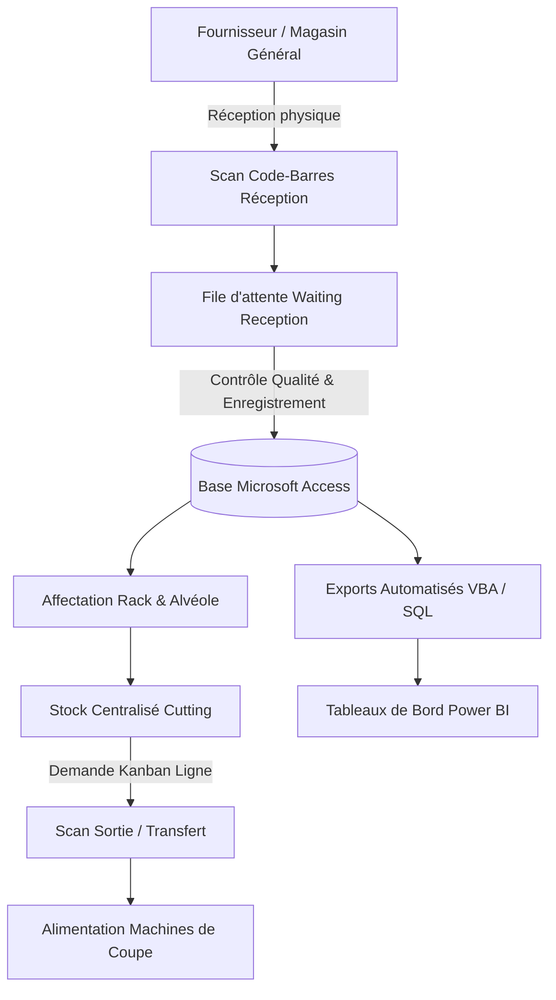

# Architecture & Fonctionnement Opérationnel // Lear Corporation

## 1. Contexte Industriel (Département Cutting)
Au sein du département Cutting de **Lear Corporation**, la production de faisceaux électriques automobiles dépend de terminaux métalliques spécifiques sertis sur les conducteurs électriques. La rupture ou l'erreur de référence sur un terminal entraîne un arrêt immédiat de ligne de coupe ou un défaut qualité critique.

### Problématiques initiales :
- Dispersion des références de terminaux dans les zones de stockage temporaires.
- Temps de recherche élevé pour les opérateurs de sertissage.
- Manque de visibilité en temps réel sur l'état des réceptions fournisseurs (*Waiting Reception*).
- Risque d'erreur humaine lors de la saisie manuelle des numéros de lot et références.

---

## 2. Modules Fonctionnels de la Solution

### A. Identification & Scan Code-Barres
- Intégration d'une douchette code-barres (émulation clavier / COM) pour scanner instantanément les étiquettes de bobines de terminaux (Code 128 / DataMatrix).
- Validation automatique de la cohérence de la référence avant écriture en base.

### B. Gestion des Racks & Emplacements
- Modélisation spatiale des racks de stockage : `Allée` - `Rack` - `Niveau` - `Position`.
- Algorithme d'assistance au rangement pour maximiser la densité d'occupation et regrouper les références à forte rotation (méthode ABC).

### C. Boucle Kanban & Réapprovisionnement
- Calcul dynamique du seuil de réapprovisionnement en fonction de la cadence de coupe.
- Génération d'alertes visuelles lorsque le stock disponible franchit le seuil critique.

### D. Pilotage par Power BI
- Extraction des mouvements de stock et temps de séjour.
- Indicateurs clés :
  - **Taux de disponibilité des terminaux**
  - **Temps moyen d'affectation en rack**
  - **Délai de traitement en Waiting Reception**
  - **Taux de rotation par famille de faisceau**
